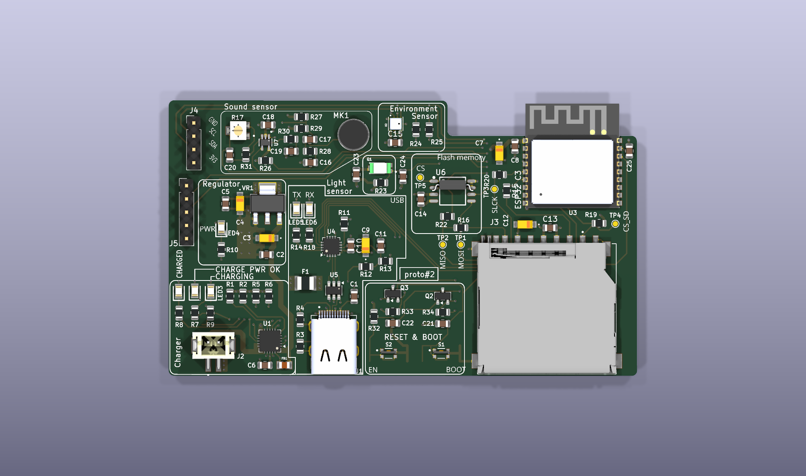
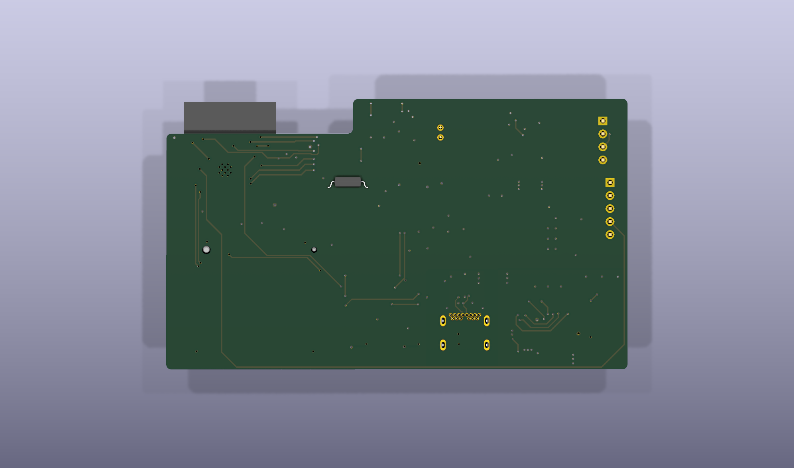
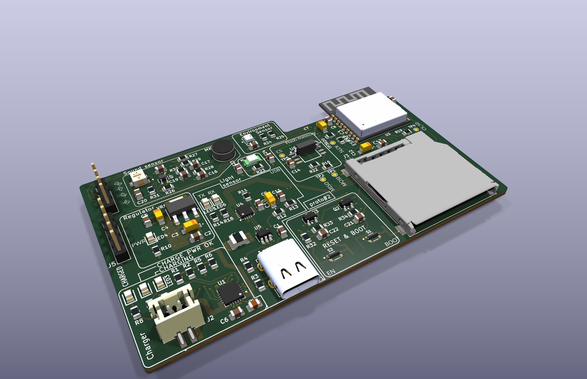
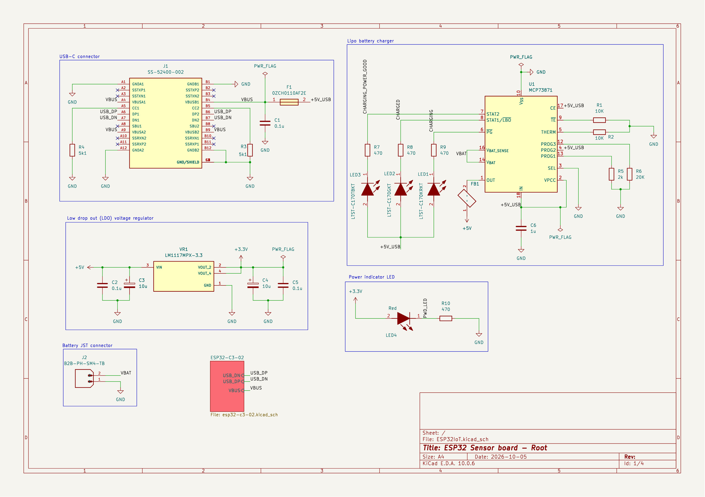
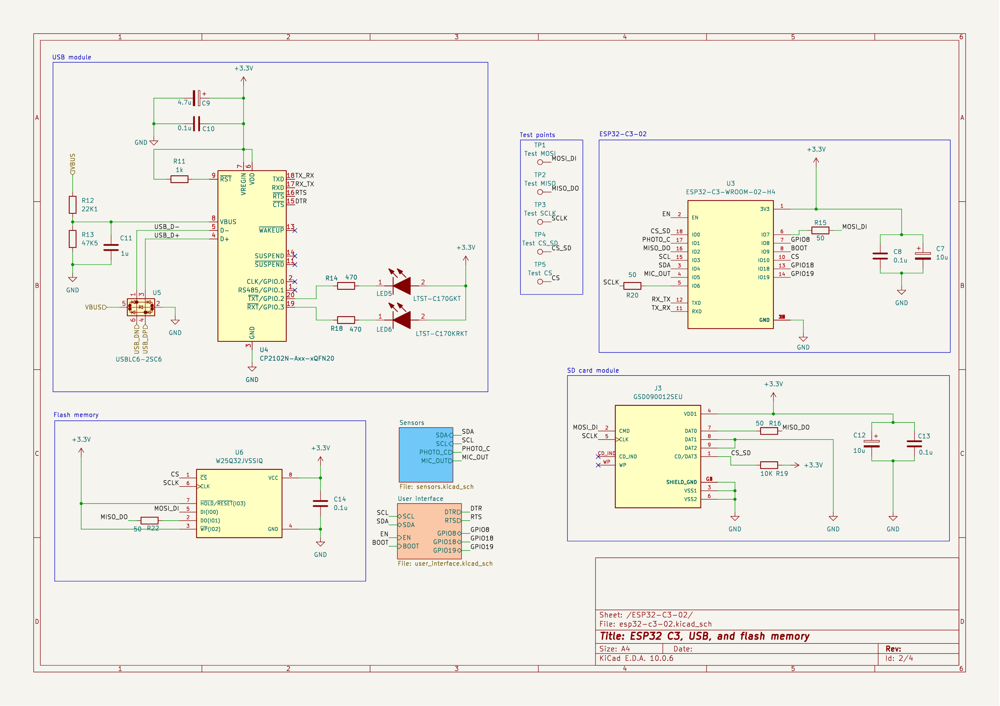
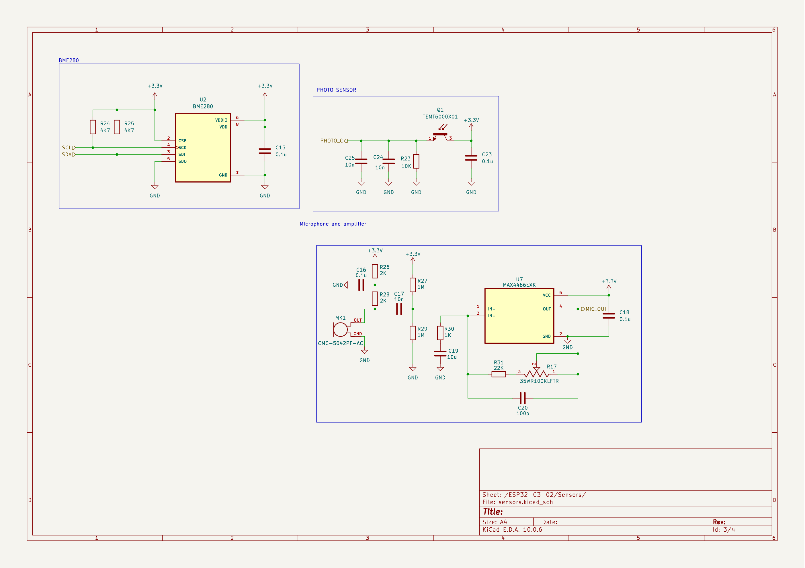
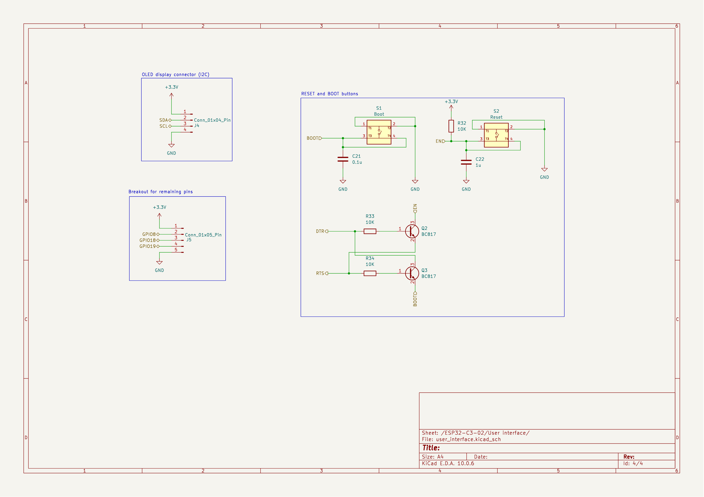

# ESP32IoT sensor board

A compact, battery-powered, Wi-Fi/Bluetooth LE sensor board built around the
**ESP32-C3-WROOM-02-H4**. It logs temperature, humidity, pressure, light and sound,
stores data on a microSD card and external flash, and charges a single-cell LiPo
from USB-C. The same USB-C port programs the ESP32 automatically.

## Features

**Board**
- 4-layer PCB, 1.6 mm thick, **90 x 53 mm**
- 90 components, 79 nets, 985 track segments, 167 vias
- Single-sided assembly (all parts on the top side), 0805 passives

**Processing and wireless**
- ESP32-C3-WROOM-02-H4: 32-bit RISC-V at up to 160 MHz, 4 MB flash, 2.4 GHz Wi-Fi (802.11 b/g/n) and Bluetooth 5 LE, on-module antenna
- Extra W25Q32JVSSIQ SPI flash: 32 Mbit (4 MB)
- microSD slot on the SPI bus, with test points on MOSI, MISO, SCLK, CS and CS_SD

**Sensors**
- BME280: temperature, humidity and barometric pressure over I2C (4.7 kOhm pull-ups on SDA/SCL)
- TEMT6000X01 ambient-light phototransistor, read on an ADC pin
- CMC-5042PF-AC electret microphone with a MAX4466 amplifier and a 100 kOhm gain trimmer (R17)

**Power**
- USB-C input, 5 V, with a 1.1 A resettable fuse (F1) and USBLC6-2SC6 ESD protection on D+/D-
- MCP73871 LiPo charger with power-path management: fast-charge current about 500 mA (R5 = 2 kOhm), status on 3 LEDs (charging, charged, power good)
- LM1117-3.3 regulator, 800 mA rating, feeding the 3.3 V rail
- JST-PH 2 mm connector for a single-cell LiPo
- Ferrite bead (FB1) between the charger output and the 5 V rail

**USB and programming**
- CP2102N USB-to-UART bridge
- Auto-reset and auto-boot circuit (2 BC817 transistors on DTR/RTS) so the ESP32 programs over USB with no button presses
- EN (reset) and BOOT push-buttons

**Expansion and indicators**
- 4-pin I2C header (3V3, GND, SDA, SCL)
- 5-pin GPIO header (GPIO8, GPIO18, GPIO19, 3V3, GND)
- 6 LEDs: 3 charger status, 1 power, 1 UART TX, 1 UART RX
- 5 test points for the SPI signals

## Gallery

| Top | Bottom |
|---|---|
|  |  |

## Schematics

| Sheet | File |
|---|---|
| Power, charger and regulator | [01-power-and-charging.png](docs/schematics/01-power-and-charging.png) |
| ESP32-C3, USB bridge, flash, SD card | [02-esp32-c3-and-usb.png](docs/schematics/02-esp32-c3-and-usb.png) |
| Sensors (BME280, light, microphone) | [03-sensors.png](docs/schematics/03-sensors.png) |
| User interface (buttons, auto-reset, headers) | [04-user-interface.png](docs/schematics/04-user-interface.png) |

### Power and charging

### ESP32-C3, USB and storage

### Sensors

### User interface

## Project files

| Path | Contents |
|---|---|
| `ESP32IoT.kicad_pro` | KiCad 10 project |
| `ESP32IoT.kicad_sch` + `esp32-c3-02`, `sensors`, `user_interface` sheets | Hierarchical schematic |
| `ESP32IoT.kicad_pcb` | Routed 4-layer board |
| `Symbols/`, `Footprints/`, `3D models/` | Project libraries |
| `BOM.ods`, `BOM11.xlsx` | Bill of materials |
| `docs/` | Renders and schematic images used by this README (`docs/schematics/ESP32IoT-schematic.pdf` is the full vector schematic) |

